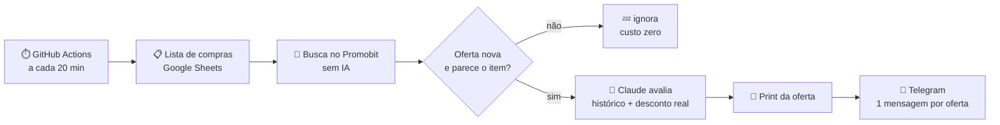

# 📡 Radar de Ofertas

[](https://github.com/leonardof-cardoso/radar-de-ofertas/actions/workflows/radar.yml)


Monitor de promoções que acompanha uma lista de compras e avisa no Telegram quando aparece uma oferta que vale a pena — com print da página, histórico de preços e um veredito.

## Como funciona



- **Barato por padrão:** a busca e os filtros rodam sem IA. O Claude só é chamado quando surge uma oferta nova que passou no pré-filtro de palavras-chave, e cada oferta é avaliada uma única vez.
- **Histórico de preços:** cada busca registra os preços vistos para o item. A IA recebe menor preço, mediana e desconto real, e descarta descontos inflados.
- **Sem repetição:** reposts da mesma oferta (outro ID, mesmo produto e preço) são ignorados.
- **Alertas que chamam atenção:** super promoções (menor preço já visto ou desconto real alto) marcam todos do grupo.

## Exemplo de alerta

```
🚨🚨 SUPER PROMOÇÃO 🚨🚨 @fulano @ciclana

🔥 Air Fryer - Mondial 4L AFN-40-BFT
💰 Agora: R$ 224,00 na Amazon (antes R$ 716,90, -69%)
📉 Histórico: R$ 389 (12/10), R$ 349 (20/10) — menor preço já visto
✅ Veredito: vale comprar agora, nunca esteve tão barata.
🎟️ Cupom: VOCEPRIME
[🛒 Ver oferta] [📈 Histórico de preços]
```

## Configuração

1. Crie um bot com o [@BotFather](https://t.me/BotFather) e adicione ao grupo.
2. Monte a planilha com as colunas `Ambiente`, `Item`, `Modelo / Marca`, `Prioridade`, `Comprado`, `Preço máximo (R$)` e compartilhe como "qualquer pessoa com o link pode ver".
3. Cadastre os secrets do repositório:

| Secret | O que é |
|---|---|
| `ANTHROPIC_API_KEY` | Chave da API da Anthropic |
| `TELEGRAM_TOKEN` | Token do bot |
| `TELEGRAM_CHAT_ID` | ID do grupo |
| `SHEET_CSV_URL` | `https://docs.google.com/spreadsheets/d/<ID>/export?format=csv` |
| `MENCOES` | Quem marcar nas super promoções: `id:Nome,@username` |

O estado (ofertas vistas e histórico) fica no cache do GitHub Actions, fora do repositório.

## Rodando localmente

```bash
pip install -r requirements.txt
python agent.py --teste   # testes rápidos
python agent.py           # uma rodada de busca
```
